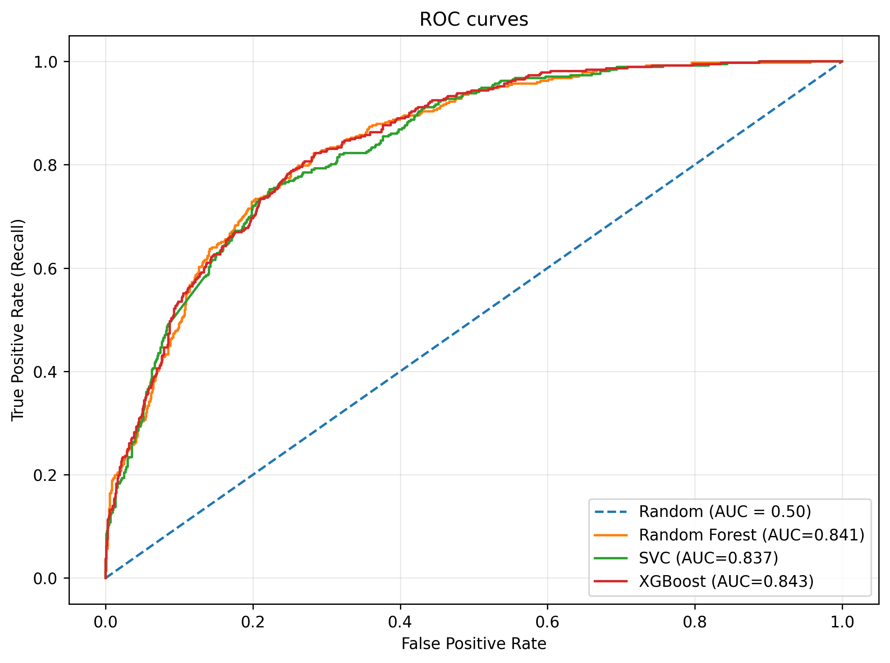
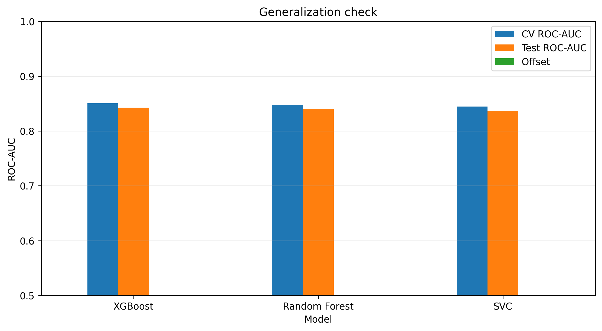
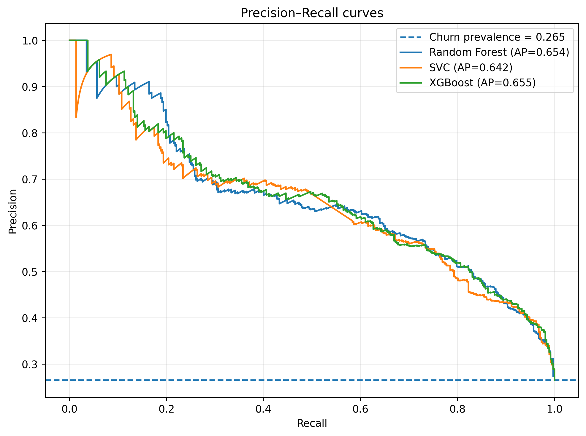
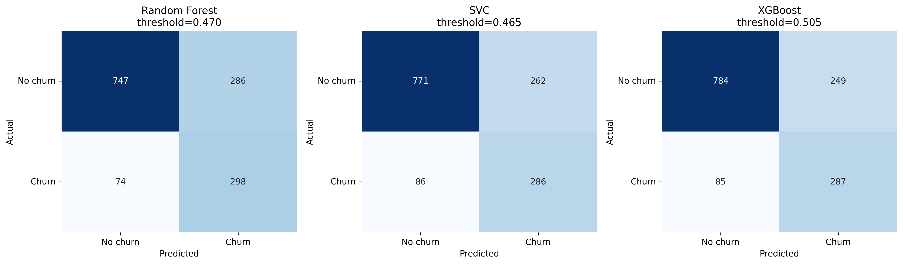
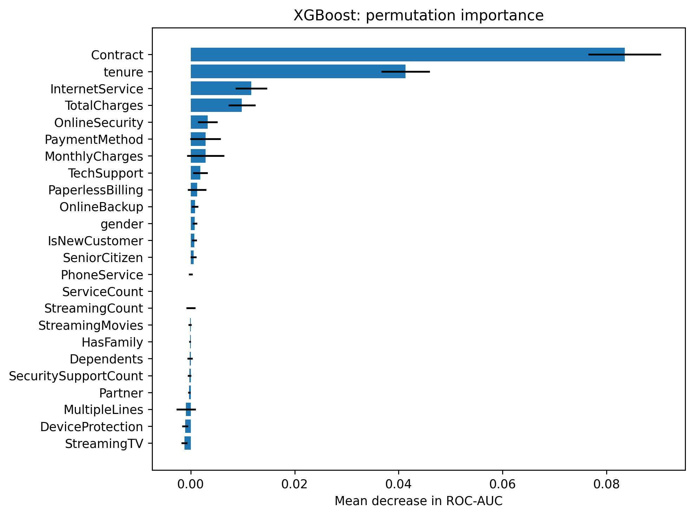

# To Catch a Churner

Predicting telco customer churn — a complete, reproducible machine-learning project: exploratory data analysis, careful preprocessing, and a rigorous comparison of **Random Forest**, **SVC**, and **XGBoost** classifiers, where the champion model is chosen on a held-out test set that was never touched during tuning.

<p align="center">
  
</p>

| | |
|---|---|
| **Dataset** | [Kaggle — Telco Customer Churn](https://www.kaggle.com/datasets/blastchar/telco-customer-churn) (7,043 customers, 20 columns) |
| **Champion** | XGBoost — held-out ROC-AUC **0.8426**, F1 **0.6322** at the OOF-selected threshold 0.505 |
| **Models available** | All three trained pipelines as `.joblib` files in the **v1.0.0** GitHub release |
| **Python** | 3.14 (environment managed with [uv](https://docs.astral.sh/uv/)) |
| **Random seed** | `42` everywhere (split, CV, search, models, importance) |

## Contents

- [Results](#results)
- [Dataset](#dataset)
- [Project structure](#project-structure)
- [Pipeline walkthrough](#pipeline-walkthrough)
- [Key design decisions](#key-design-decisions)
- [Reproducing from scratch](#reproducing-from-scratch)
- [Pre-trained models](#pre-trained-models)
- [Requirements](#requirements)
- [Credits](#credits)
- [License](#license)

## Results

Three classifiers were trained as scikit-learn `Pipeline`s (preprocessor + estimator), tuned with `RandomizedSearchCV` (40 random candidates × 5-fold stratified CV, refit on ROC-AUC), and then evaluated once on a single held-out test set (20%, stratified, `random_state=42`).

### Held-out test set (n = 1,405, churn rate 26.48%)

| Metric | Random Forest | SVC | XGBoost (champion) |
|---|---|---|---|
| ROC-AUC | 0.8408 | 0.8365 | **0.8426** |
| Average Precision | 0.6545 | 0.6418 | **0.6554** |
| Accuracy | 0.7438 | 0.7523 | **0.7623** |
| Balanced Accuracy | 0.7621 | 0.7576 | 0.7652 |
| Precision | 0.5103 | 0.5219 | **0.5354** |
| Recall | **0.8011** | 0.7688 | 0.7715 |
| Specificity | 0.7231 | 0.7464 | **0.7590** |
| F1 | 0.6234 | 0.6217 | **0.6322** |
| F2 | **0.7191** | 0.7024 | 0.7090 |
| MCC | 0.4693 | 0.4660 | **0.4818** |
| Brier score | 0.1603 | **0.1552** | 0.1594 |
| Log loss | 0.4796 | **0.4673** | 0.4758 |
| Decision threshold | 0.470 | 0.465 | 0.505 |

Champion (XGBoost) confusion matrix: TP 287, FP 249, TN 784, FN 85.

### Cross-validation (5-fold stratified, best of 40 candidates per model)

| Model | CV ROC-AUC | CV Average Precision | CV F1 |
|---|---|---|---|
| XGBoost | **0.8504** | **0.6685** | **0.6396** |
| Random Forest | 0.8482 | 0.6610 | 0.6353 |
| SVC | 0.8446 | 0.6598 | 0.5985 |

### Generalization

The gap between CV and held-out ROC-AUC is small and consistent across all three models (~0.007–0.008), i.e. no sign of overfitting from tuning:

| Model | CV ROC-AUC | Test ROC-AUC | Gap |
|---|---|---|---|
| Random Forest | 0.8482 | 0.8408 | 0.0074 |
| SVC | 0.8446 | 0.8365 | 0.0081 |
| XGBoost | 0.8504 | 0.8426 | 0.0078 |

<p align="center">
  
  
</p>

### What the champion sees

Permutation importance (Δ ROC-AUC, 10 repeats, held-out test set) on the XGBoost champion:

| Feature | Δ ROC-AUC |
|---|---|
| `Contract` | 0.0835 |
| `tenure` | 0.0413 |
| `InternetService` | 0.0117 |
| `TotalCharges` | 0.0099 |
| `OnlineSecurity` | 0.0032 |
| `PaymentMethod` | 0.0028 |
| `MonthlyCharges` | 0.0028 |

These are predictive associations, not causal effects. Month-to-month contract customers are by far the riskiest segment: 42.6% churn among M2M vs 11.3% one-year and 2.8% two-year.

<p align="center">
  
  
</p>

More charts live in [`Results/Charts/`](Results/Charts): threshold curves, calibration, and native feature importance. Raw numbers are in [`Results/metrics/model_test_results.csv`](Results/metrics/model_test_results.csv) and [`Results/cv_results/model_cv_results.json`](Results/cv_results/model_cv_results.json).

## Dataset

The dataset is the public **Telco Customer Churn** set from Kaggle (7,043 rows, 20 columns): monthly-charges, tenure, contract type, internet service, payment method, add-on services, and the binary target `Churn`.

**The raw CSV is intentionally not in this repository.** Download it from the [Kaggle page](https://www.kaggle.com/datasets/blastchar/telco-customer-churn) and place it at:

```
Data/WA_Fn-UseC_-Telco-Customer-Churn.csv
```

After cleaning (22 exact duplicates dropped, 11 missing `TotalCharges` filled) the modeling frame is **7,021 × 24** (23 features + target), with a churn rate of **26.5%**.

## Project structure

```
.
├── Notebooks/
│   ├── EDA.ipynb            # Exploratory data analysis
│   ├── PreProcessing.ipynb  # Cleaning, feature engineering, 80/20 split
│   ├── ML.ipynb             # Model comparison, CV, threshold selection, final training
│   └── Results.ipynb        # Held-out evaluation, charts, subgroup diagnostics
├── Results/
│   ├── Charts/              # All published figures (PNG)
│   ├── cv_results/          # CV scores + best params per model (JSON)
│   └── metrics/             # Held-out test metrics (CSV)
├── Data/                    # (gitignored) raw Kaggle CSV — see Dataset section
├── DataFrames/              # (gitignored, regenerable) X/y train-test parquets
├── Artifacts/               # (gitignored, regenerable) CV splitter pickle
├── Models/                  # (gitignored) final .joblib pipelines — see GitHub release
├── pyproject.toml           # Project metadata + dependencies
├── uv.lock                  # Fully resolved dependency lock
└── .python-version          # 3.14
```

## Pipeline walkthrough

Run the notebooks in order; each one ends by saving exactly what the next one needs.

### 1. `EDA.ipynb` — what the data says

- `customerID` dropped as non-predictive; `TotalCharges` coerced to numeric, `SeniorCitizen` treated as categorical.
- Missing values: only `TotalCharges` (11 rows, 0.156%). All 11 share `tenure=0`, so filling with `0` ("no accumulated charges yet") is semantically correct.
- 22 exact duplicate rows removed.
- No outliers deleted: high-charge customers are a real profile, and tree models are insensitive to monotonic scaling.
- Key signals (churn rate by group): **Contract** (M2M 42.6% vs two-year 2.8%), **InternetService** (Fiber 41.8% vs DSL 18.9%), **PaymentMethod** (Electronic check 45.2%), and missing add-on services (no OnlineSecurity: 41.6%).

### 2. `PreProcessing.ipynb` — cleaning, features, split

- 5 deterministic, row-level features engineered: `ServiceCount`, `StreamingCount`, `SecuritySupportCount`, `HasFamily`, `IsNewCustomer` (tenure ≤ 6).
- Train/test split: `test_size=0.20, stratify=y, random_state=42` → 5,616 train / 1,405 test, both at ~26.5% churn.
- The target is saved **separately** from the features so it can never leak in as a column.
- The single test set is the "final exam": it is used once, in `Results.ipynb`, and is never consulted for tuning or thresholding.
- Collinearity was measured (VIF up to 10.2 for `TotalCharges`) but no feature was dropped — tree models tolerate collinearity.
- Outputs: `DataFrames/{X_train,X_test,y_train,y_test}.parquet`, `Artifacts/skf.pkl` (the `StratifiedKFold(5, shuffle=True, random_state=42)` object reused for OOF scoring).

### 3. `ML.ipynb` — three competing pipelines

Every model is a `Pipeline` of (preprocessor, estimator) so preprocessing can never leak:

| Model | Preprocessor | Estimator (best params) |
|---|---|---|
| Random Forest | median imputation + one-hot (`drop="if_binary"`) | `n_estimators=200, max_depth=None, min_samples_leaf=8, min_samples_split=2, max_features="log2", class_weight="balanced"` |
| SVC | same + `StandardScaler` | RBF kernel, `probability=True`, `class_weight="balanced"`, `C=21.37, gamma=7.07e-4` |
| XGBoost | tree preprocessor only | `n_estimators=100, max_depth=5, lr=0.0271, subsample=0.6, colsample_bytree=0.6, min_child_weight=5, gamma=0.5, alpha=0.01, lambda=2, scale_pos_weight=2.782` |

- **Search:** `RandomizedSearchCV`, 40 candidates per model, 5-fold stratified CV, scoring on `{roc_auc, average_precision, f1}`.
- **Class imbalance:** no resampling — handled via `class_weight="balanced"` (RF, SVC) and `scale_pos_weight = 2.782` (= neg/pos ratio) for XGBoost. SMOTENC was prototyped and deliberately abandoned.
- **Threshold selection (no test-set peeking):** out-of-fold probabilities via `cross_val_predict` → threshold = argmax of F-beta (β=1) over a 181-point grid → RF 0.470, SVC 0.465, XGBoost 0.505.
- **XGBoost refinement:** early stopping (15% stratified carve-out of the train set, `early_stopping_rounds=30`) selected **243 boosting rounds**.
- **Final training:** each best model is explicitly re-fit on the full 5,616-row train set and saved as a complete pipeline to `Models/*.joblib`.

### 4. `Results.ipynb` — the final exam

- Reloads the three saved pipelines, scores them on the untouched test set at their OOF thresholds.
- Produces all charts in `Results/Charts/`, the held-out metric tables, the CV-vs-test generalization check, and diagnostic subgroup cuts (by contract, service, tenure band — diagnostic only, no re-tuning afterwards).
- **Champion: XGBoost** (highest held-out ROC-AUC).

## Key design decisions

- **The test set is sacred.** No hyperparameter, feature choice, or threshold was ever selected using test labels; thresholds came from out-of-fold (train-only) F-beta optimization.
- **Preprocessing lives inside the pipeline.** Imputation/encoding/scaling fit only on training folds and are applied consistently at prediction time.
- **Scale only where it matters.** Standard scaling is in the SVC pipeline (metric-based model) and absent from the tree pipelines (scale-invariant).
- **No resampling.** Class weights instead of SMOTE — simpler, and the class ratio is only 2.78:1.
- **Determinism.** `random_state=42` for the split, CV, search, every estimator, OOF prediction, and permutation importance; `uv.lock` pins the exact dependency versions.
- **Honest reporting.** The CV-vs-test gap, calibration, and subgroup diagnostics are all published — including where the model is weak (two-year contract customers: zero churn predicted at the chosen threshold).

## Reproducing from scratch

1. **Install [uv](https://docs.astral.sh/uv/)** (if you don't have it):
   ```bash
   curl -LsSf https://astral.sh/uv/install.sh | sh
   ```
2. **Create the environment** (uses `.python-version` = 3.14 and `uv.lock`):
   ```bash
   uv sync
   ```
3. **Download the dataset** from the [Kaggle page](https://www.kaggle.com/datasets/blastchar/telco-customer-churn) and save it as:
   ```
   Data/WA_Fn-UseC_-Telco-Customer-Churn.csv
   ```
4. **Run the notebooks in order:**
   ```bash
   uv run jupyter notebook
   ```
   1. `Notebooks/EDA.ipynb`
   2. `Notebooks/PreProcessing.ipynb`
   3. `Notebooks/ML.ipynb`
   4. `Notebooks/Results.ipynb`

After `ML.ipynb`, your `Models/` folder contains the same pipelines shipped in the release; after `Results.ipynb`, your `Results/` folder matches the committed charts and metrics.

## Pre-trained models

The three final pipelines (preprocessor + fitted estimator, ready to `predict_proba`) are attached to the **v1.0.0 GitHub release** of this repository:

| Asset | Size |
|---|---|
| `xgboost_final_model.joblib` (champion) | ~553 KB |
| `rf_final_model.joblib` | ~7.2 MB |
| `svc_final_model.joblib` | ~1.1 MB |

```python
import joblib

model = joblib.load("xgboost_final_model.joblib")  # full sklearn Pipeline

probabilities = model.predict_proba(X_train)       # column 1 = P(churn)
churn_risk    = probabilities[:, 1]
predict_churn = churn_risk >= 0.505                # OOF-selected threshold
```

> **Security note:** `.joblib`/`.pkl` files are Python pickles. Only load them in a trusted environment, or you don't need to at all — the notebooks above regenerate everything from the raw CSV.

## Requirements

Python **3.14** (see `.python-version`), managed with `uv`:

| Package | Version | Role |
|---|---|---|
| `scikit-learn` | ≥ 1.9.0 | pipelines, CV, search, metrics |
| `xgboost` | ≥ 3.4.1 | champion model |
| `pandas` | ≥ 3.0.5 | data handling |
| `numpy` | ≥ 2.5.2 | numerics |
| `pyarrow` | ≥ 25.0.1 | parquet I/O |
| `matplotlib` / `seaborn` | ≥ 3.11.1 / ≥ 0.13.2 | plotting |
| `imblearn` | ≥ 0.0.0 | (prototyped SMOTENC, not used in final models) |
| `statsmodels` | ≥ 0.14.6 | VIF diagnostics |
| `ipykernel` | ≥ 7.3.0 | notebook runtime |

The exact resolved versions are pinned in `uv.lock`.

## Credits

- **Dataset:** *Telco Customer Churn* by [blastchar](https://www.kaggle.com/datasets/blastchar/telco-customer-churn) on Kaggle.
- **Libraries:** [XGBoost](https://xgboost.readthedocs.io/), [scikit-learn](https://scikit-learn.org/), [pandas](https://pandas.pydata.org/), [matplotlib](https://matplotlib.org/), [seaborn](https://seaborn.xyz/).
- A full technical report and a presentation for this project exist; they are intentionally kept out of the public repository.

## License

[MIT](LICENSE)
